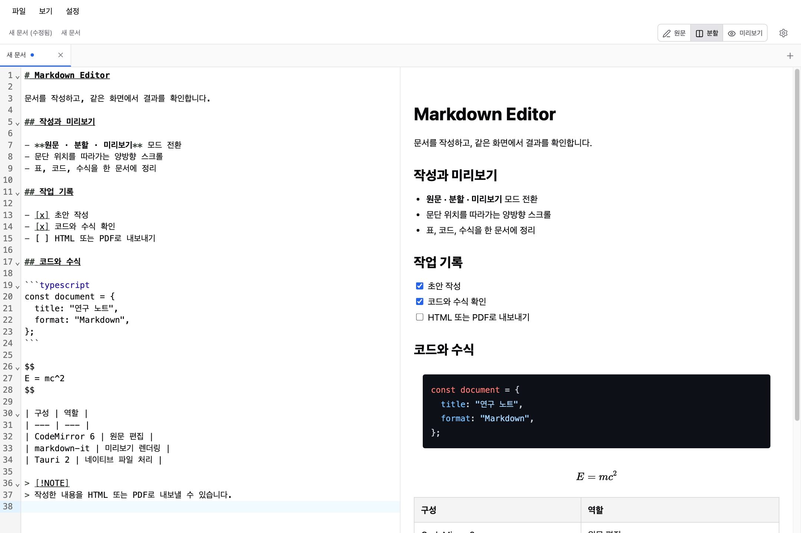
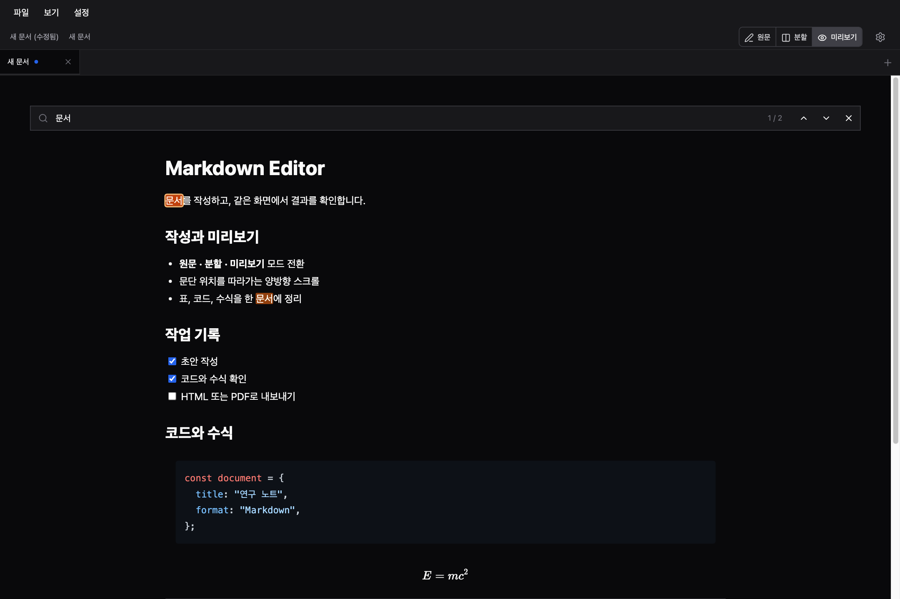

::github{repo="Hajiie/MarkdownEditor"}

# MarkdownEditor: Tauri 기반 Markdown 편집기

## 프로젝트 목표

Markdown 원문 작성, 결과 확인, 파일 저장과 내보내기를 한 앱에서 처리하기 위한 데스크톱 편집기.
Tauri의 네이티브 파일 기능과 웹 기반 편집 화면을 연결하고, 문서 내용을 보존하면서 여러 탭과 창에서 작업할 수 있도록 구현.



위 이미지는 실제 로컬 빌드를 브라우저로 실행하고 설명용 문서를 입력한 화면.
왼쪽은 CodeMirror 편집기, 오른쪽은 같은 문서의 미리보기이며 표·코드 블록·수식·체크리스트를 함께 작성할 수 있음.
브라우저에서는 앱 내부 대체 메뉴를 표시하며, 데스크톱에서는 운영체제의 네이티브 메뉴와 파일 API를 사용.

## 주요 기술 및 구현

| 구성 | 기술과 역할 |
| --- | --- |
| 데스크톱 앱 | Tauri 2와 Rust를 사용한 창·파일·운영체제 기능 연동 |
| 프런트엔드 | React·TypeScript·Vite 기반 UI, Tailwind CSS 스타일 |
| 원문 편집 | CodeMirror 6, Markdown 구문 강조·서식 명령·코드 펜스 자동완성 |
| 미리보기 | markdown-it과 플러그인을 사용한 표·각주·체크리스트·콜아웃 렌더링 |
| 코드와 수식 | highlight.js 구문 강조, KaTeX 수식 렌더링 |
| 상태 관리 | Zustand 기반 문서 탭·설정 관리, 선택한 설정과 최근 파일 기록 유지 |
| 콘텐츠 정화 | DOMPurify를 미리보기와 HTML 내보내기에 공통 적용 |

## 시스템 주요 기능

### 원문·분할·미리보기 모드

- 원문만 편집하거나, 편집기와 결과를 나란히 보거나, 미리보기만 표시하는 3가지 모드 제공.
- 분할 모드에서는 문단과 원본 줄 위치를 기준으로 양방향 스크롤 동기화. 위치를 연결할 수 없으면 전체 높이 비율로 보완.
- 다크 테마, 글자 크기, 미리보기 너비와 포커스 모드 설정.
- 미리보기 전용 모드에서는 체크박스를 클릭해 원문을 바꿀 수 있으며, 일반 본문을 직접 편집하는 기능은 제공하지 않음.

### Markdown 편집과 문서 검색

- 굵게·기울임·링크 등 서식을 선택 영역이나 현재 커서 위치에 적용.
- 코드 블록 자동 닫기와 언어명 자동완성, 표 셀 안의 줄바꿈 지원.
- 각주, 하이라이트, GitHub 스타일 콜아웃과 수식 표시.
- 미리보기에서 찾은 단어를 강조하고 이전·다음 결과로 이동. 검색 강조는 원문 내용을 변경하지 않음.
- 데스크톱의 찾기 명령은 원문과 미리보기 중 포커스가 있는 영역으로 전달. `Cmd/Ctrl+F`로 찾기, `Cmd/Ctrl+G`와 `Cmd/Ctrl+Shift+G`로 결과 이동.



로컬 브라우저 실행에서 미리보기 검색어 `문서`의 강조와 `1 / 2` 결과 표시를 확인한 화면.

### 문서 탭과 여러 창

- 새 문서와 열린 파일을 각각 탭으로 유지하고 탭별 수정 상태를 표시.
- 데스크톱에서는 탭을 밖으로 끌거나 창 메뉴를 사용해 별도 창으로 분리.
- 분리한 탭을 다른 창으로 합칠 때 저장하지 않은 수정 내용과 저장 기준도 함께 전달.
- 대상 창이 수신을 확인하기 전에는 원래 탭을 닫지 않으며, 전송이 거절되면 원래 문서를 유지.
- macOS 파일 열기 이벤트와 Windows의 기존 앱 인스턴스로 파일을 전달하는 동작 지원.

### 저장과 수정 내용 보호

- 문서를 닫을 때 저장·버리기·취소를 확인하고, 저장 실패나 취소 시 현재 문서를 유지.
- 파일 작업의 중복 실행을 차단하고 문서별 저장 기준을 관리.
- 데스크톱에서는 자동저장 여부와 대기 시간을 설정. 브라우저에서는 파일 선택과 다운로드를 사용하므로 원본 덮어쓰기·자동저장을 지원하지 않음.
- 최근 파일의 접근 권한을 복원하고, 권한이 없는 이전 기록은 파일 선택 창에서 다시 선택하도록 안내.
- 종료 전 저장 확인은 제공하지만, 강제 종료 후 저장하지 않은 문서를 복구하는 기능까지 구현된 것은 아님.

### 이미지 삽입과 내보내기

- 데스크톱에서는 이미지 선택·붙여넣기·드롭을 통해 문서 옆 `markdown-assets/`에 파일을 복사하고 상대 경로 삽입.
- 10MB 이하 PNG·JPEG·GIF·WebP·AVIF를 지원하며, 새 문서는 먼저 저장 위치를 선택.
- 브라우저에서는 이미지를 `data:` URL로 문서에 내장하므로 문서 크기가 커질 수 있음.
- 외부 HTTP(S) 이미지는 기본 차단하고, 설정에서 사용자가 허용한 경우에 표시.
- HTML 내보내기는 현재 테마, 미리보기·코드 강조 CSS, KaTeX 폰트와 접근 가능한 로컬 이미지를 단일 파일에 포함. 외부 이미지는 URL로 유지.
- PDF 내보내기는 문서만 시스템 인쇄 창으로 전달. 인쇄 창에서 PDF 저장 대상을 선택하며, 취소하면 파일을 생성하지 않음.

## 실행과 확인

개발 환경은 Node.js 22를 기준으로 구성.

```bash
nvm use
npm ci
npm run dev
```

브라우저 개발 서버의 기본 주소는 `http://localhost:1420`.
Rust와 운영체제 빌드 도구를 설치한 환경에서는 `npm run tauri dev`로 데스크톱 앱 실행.

이 글의 이미지는 2026년 11월 17일 기준 커밋 `a8b547f`를 로컬에서 빌드해 캡처.
분할 미리보기의 표·수식·코드 렌더링과 다크 테마의 미리보기 검색을 직접 확인.
창 사이 탭 이동, Finder·Explorer 파일 연결, 네이티브 저장과 인쇄 창은 이 브라우저 캡처로 검증한 항목에 포함되지 않음.

---

# MarkdownEditor 트러블슈팅 정리

## 1. macOS에서 문서를 열며 앱을 실행할 때 충돌

문제 및 원인
- 앱의 `Ready` 이벤트보다 파일 열기 이벤트가 먼저 들어오면 초기 창 구성과 창 재생성 시점이 겹칠 수 있었음.

해결 방법
- 파일 경로는 대기열에 보관하고 초기 기본 창은 Tauri 설정 단계에서 생성.
- `Ready` 이후에만 파일 열기나 Dock 재활성화에 따른 창 재생성을 허용하도록 변경.

## 2. 최근 파일의 경로는 남아 있지만 다시 열리지 않는 문제

문제 및 원인
- 최근 파일 경로를 저장하는 것만으로 앱 재시작 후 Tauri의 파일 접근 권한이 유지되지는 않음.

해결 방법
- 파일 접근 범위를 영속화하고, 접근 거부 시 파일 선택 창에서 다시 권한을 부여하도록 처리.
- 파일 없음·권한·인코딩 등의 오류를 구분하며 실패했다고 최근 기록이나 현재 문서를 자동으로 지우지 않음.

## 3. 내보낸 HTML에서 글꼴과 수식 스타일이 사라지는 문제

문제 및 원인
- 앱 화면의 CSS와 KaTeX 폰트가 독립 HTML 파일에 따라가지 않아 표현이 달라짐.

해결 방법
- 내보낼 HTML에 미리보기·코드 강조 스타일과 수식 폰트를 포함.
- 접근 가능한 로컬 이미지도 내장하고, 미리보기와 같은 정화 정책을 적용.

## 4. 여러 창 사이의 탭 전송과 메뉴 충돌

문제 및 원인
- 대상 창의 문서 수신 확인 없이 원래 탭을 닫으면 수정 내용이 유실될 수 있음.
- 여러 창이 같은 네이티브 메뉴 ID를 사용하면 클릭을 처리하는 채널이 충돌할 수 있음.
- Windows에서 동기 명령으로 WebView 창을 생성할 때 교착 상태가 발생할 수 있었음.

해결 방법
- 문서 수신 확인 후 원본 탭을 닫는 절차를 적용하고, 실패하면 원래 탭 유지.
- 메뉴 ID를 창별로 구분하고 macOS의 창 포커스·닫힘 이후 메뉴를 다시 연결.
- 창 생성 명령을 비동기로 변경. 실제 운영체제 창 사이 드래그와 메뉴 전환은 설치본에서도 별도 확인이 필요.

## 5. 검색 강조가 원문과 섞이지 않도록 처리

문제 및 원인
- 렌더링된 문서에 검색 표시를 넣으면서 원문을 수정하거나, 수식 내부를 분리하면 문서 내용과 표시가 달라질 수 있음.

해결 방법
- 미리보기의 텍스트 노드에만 검색 표시를 추가하고, KaTeX·SVG 등의 내부는 검색 대상에서 제외.
- 검색어를 정규식의 일반 문자열로 처리하고 현재 결과와 전체 결과 수를 관리.
- 미리보기 검색·이전·다음 이동과 원문 불변 동작을 회귀 테스트에 추가.

## 관련 구현 기록

- [문서 탭과 클릭 가능한 체크리스트](https://github.com/Hajiie/MarkdownEditor/commit/138817ac2066c24be3f90bf34cc3e070fd00be5e)
- [원문·분할·미리보기 모드](https://github.com/Hajiie/MarkdownEditor/commit/2bfb7aaada2f384df84c5322ebf083764880ce5a)
- [문서와 내보내기의 로컬 이미지 지원](https://github.com/Hajiie/MarkdownEditor/commit/977a6d9a37c3b9833a292812b9eaedcfbb6729fe)
- [창 사이 탭 드래그와 배치 수정](https://github.com/Hajiie/MarkdownEditor/commit/606752377694fc7978047f7c72a296c68c9ab0bd)
- [macOS 실행 중 문서 열기 충돌 수정](https://github.com/Hajiie/MarkdownEditor/commit/56e843cef9e8a83d7f4289988be5474ff064b57c)
- [미리보기 검색과 네이티브 찾기 명령](https://github.com/Hajiie/MarkdownEditor/commit/a8b547fbed5ab9fecdf7dd69292a979dfe96c134)
